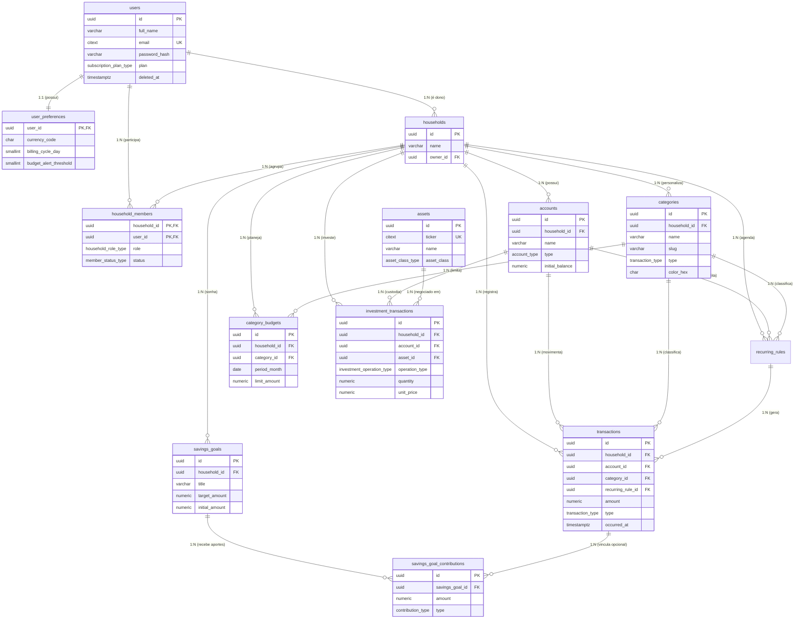

# Documentação de Arquitetura e Guia de Estudo do Banco de Dados — Biana Finance

> **Nota Pessoal do Desenvolvedor (Compromisso de Aprendizado):**
> Estou em um dilema, meu objetivo neste webapp era criar todo o backend sozinho com mínima ajuda da IA, porém quando cheguei nesta parte de banco percebi que o conhecimento que tenho nessa disciplina não é o suficiente para fazer algo sério e usável. Eu até consigo fazer algo mas extremamente simples o que acabaria prejudicando o sistema quando for para produção então tomei a decisão por livre escolha e sabendo que ela fere um dos princípios de construir esse software de usar IA para fazer o banco PORÉM com algumas ressalvas que são:
> - Quando terminado o banco eu tenho que estudá-lo por inteiro e entender todos os relacionamentos que contém dentro dele e suas regras como 1 para N, N para N etc.
> - Eu tenho que fazer uma anotação explicando os conceitos e relacionamentos.
> - Tenho que pensar e ver se a construção da IA tem redundâncias.

---

## 1. Visão Geral e Diagrama Entidade-Relacionamento (DER)

O banco de dados do **Biana Finance** foi projetado para **PostgreSQL 16+** seguindo a **3ª Forma Normal (3FN / 3NF)**, garantindo **zero redundância de dados**, integridade contábil estrita e alta performance para o motor de cálculos em **Rust**.



---

## 2. Boas Práticas de Produção Aplicadas (e Por Que Importam)

### 2.1. Precisão Monetária Absoluta (`NUMERIC(15, 2)` vs `FLOAT`)
- **O Problema:** Em programação e bancos de dados, tipos de ponto flutuante binário (`FLOAT`, `REAL`, `DOUBLE PRECISION`) sofrem de imprecisão IEEE-754 (ex: `0.1 + 0.2 = 0.30000000000000004`). Em um sistema financeiro de produção, isso gera diferenças de centavos em auditorias e conciliações bancárias.
- **A Boa Prática:** Utilizamos `NUMERIC(15, 2)` para todos os valores fiduciários (suporta até `R$ 9.999.999.999.999,99` com exatidão decimal absoluta) e `NUMERIC(18, 8)` na tabela `investment_transactions` para quantidades fracionárias de ativos (como criptoativos ou frações de ETFs).
- **Sinal Contábil Sem Ambiguidade:** Toda coluna `amount` tem uma constraint `CHECK (amount > 0)`. O banco **jamais** aceita valores negativos ou zerados em uma transação; o que define se o dinheiro entrou ou saiu é estritamente a coluna `type` (`'income'` ou `'expense'`). Isso evita o clássico bug de produção de "somar um gasto negativo com outro sinal negativo e virar positivo".

### 2.2. Chaves Primárias UUID v4 Nativas (`UUID DEFAULT gen_random_uuid()`)
- **O Problema:** Usar `SERIAL` ou `INTEGER` (`1, 2, 3...`) expõe a volumetria do negócio e facilita ataques de **IDOR (Insecure Direct Object Reference)** na API (um atacante testa `/api/transactions/1045`, `/api/transactions/1046`). Além disso, salvar UUID como `VARCHAR(36)` desperdiça espaço em disco e deixa os índices lentos.
- **A Boa Prática:** Usamos o tipo nativo `UUID` do PostgreSQL (armazenado como um binário compacto de 16 bytes / 128 bits) gerado automaticamente pelo banco via `gen_random_uuid()`.

### 2.3. Eliminação Total de Redundâncias (3ª Forma Normal — 3FN)
Para atender ao seu critério de **zero redundância**, analisamos três armadilhas comuns que iniciantes cometem e as eliminamos:

1. **Armadilha 1: Salvar `spent` (valor gasto) dentro da tabela `category_budgets` (Teto de Gastos)**
   - *Por que seria redundante?* O valor gasto em `"Alimentação"` em Outubro/2026 já é a soma das linhas da tabela `transactions` daquela categoria naquele mês. Se criássemos uma coluna `spent` em `category_budgets`, toda vez que uma transação fosse criada, editada ou deletada, o backend teria que lembrar de atualizar duas tabelas. Se uma falhasse, o orçamento ficaria corrompido (**Anomalia de Atualização**).
   - *Como resolvemos:* A tabela `category_budgets` guarda **apenas** o limite planejado (`limit_amount`). Criamos a View `vw_category_budget_consumption` que calcula o `spent_amount`, `remaining_amount` e `consumed_percentage` em tempo real direto das transações!
2. **Armadilha 2: Salvar strings de Categoria, Cor e Ícone repetidas em cada linha de `transactions`**
   - *Por que seria redundante?* Se o usuário tiver 10.000 transações de `"Alimentação"` e você salvar o texto `'Alimentação'` e a cor `'#3B6750'` em cada transação, você desperdiça armazenamento e, se decidir mudar a cor ou o nome da categoria, precisará atualizar 10.000 linhas.
   - *Como resolvemos:* Criamos a tabela `categories` e referenciamos apenas `category_id` em `transactions`, `recurring_rules` e `category_budgets`.
3. **Armadilha 3: Duplicar dados de ativos da Bolsa para cada usuário**
   - *Por que seria redundante?* Se 5.000 famílias comprarem `WEGE3`, não devemos criar 5.000 registros dizendo que `WEGE3` se chama `"WEG S.A."` do setor `"Bens Industriais"`.
   - *Como resolvemos:* A tabela `assets` é um catálogo único global (`ticker UNIQUE`), e `investment_transactions` conecta a família ao ativo.

### 2.4. Arquitetura Multi-Tenant Familiar (`households`)
- Em vez de amarrar `accounts` e `transactions` diretamente ao `user_id` (o que impediria que sua esposa/cônjuge ou filhos visualizassem o orçamento da família na tela de Configurações), criamos a entidade **`households` (Núcleo Familiar)**.
- Se um usuário criar conta sozinho, o backend cria 1 `household` para ele. Se no futuro ele convidar membros da família, basta adicionar uma linha em `household_members` — **nenhuma transação ou conta bancária precisa ser migrada!**

### 2.5. Datas com Fuso Horário (`TIMESTAMPTZ`) e Exclusão Lógica (`Soft Delete`)
- **`TIMESTAMPTZ`:** Armazena o instante exato em UTC no servidor e converte para o fuso horário de São Paulo (`-03:00`) na leitura, evitando que uma compra feita às 22h do dia 31 caia no mês seguinte por diferença de fuso do container Docker.
- **`deleted_at` (Soft Delete):** Nas tabelas `users` e `transactions`, em vez de destruir o registro com `DELETE` físico imediatamente, preencher `deleted_at` permite ocultar o item da interface mantendo rastreabilidade e permitindo desfazer exclusões acidentais.

### 2.6. Regras de Exclusão (`ON DELETE RESTRICT` vs `CASCADE` vs `SET NULL`)
- **`ON DELETE RESTRICT`** em `transactions.account_id` e `transactions.category_id`: Impede que alguém apague uma conta bancária ou categoria que já possui movimentações financeiras reais, protegendo a contabilidade.
- **`ON DELETE CASCADE`** em `household_members`, `user_preferences` e `savings_goal_contributions`: Se a entidade pai for removida, seus dependentes diretos que não existem sozinhos são limpos automaticamente.
- **`ON DELETE SET NULL`** em `transactions.created_by_user_id` e `transactions.recurring_rule_id`: Se um membro secundário sair da família ou uma regra de recorrência for apagada, as transações passadas continuam existindo intactas no histórico da família.

---

## 3. Guia Completo dos Relacionamentos (`1:1`, `1:N`, `N:N`)

Use esta seção para o seu estudo prático de como os relacionamentos funcionam em SQL:

### 3.1. Relacionamento `1 para 1` (`1:1`)
> **Regra:** Uma linha da Tabela A se conecta a **no máximo uma** linha da Tabela B, e vice-versa.
- **Onde acontece no Biana Finance:** `users` $\leftrightarrow$ `user_preferences`
- **Como é construído no SQL:**
  Na tabela `user_preferences`, a coluna `user_id` é **ao mesmo tempo** a `PRIMARY KEY` (o que impede que o mesmo usuário tenha duas linhas de preferência) e uma `FOREIGN KEY` apontando para `users(id)`.
- **Por que não colocar tudo na tabela `users`?**
  Separar dados de autenticação (`email`, `password_hash`) de configurações de interface (`billing_cycle_day`, `notify_push`) mantém a tabela `users` leve, rápida e segura.

### 3.2. Relacionamento `1 para N` (`1:N` — Um para Muitos)
> **Regra:** Uma linha da Tabela Pai pode ter **zero, uma ou várias** linhas na Tabela Filha, mas cada linha da Tabela Filha pertence a **apenas um** Pai.
- **Onde acontece no Biana Finance:**
  1. `households` (1) $\rightarrow$ (N) `accounts` *(Uma família tem várias contas bancárias, mas uma conta pertence a uma única família).*
  2. `accounts` (1) $\rightarrow$ (N) `transactions` *(Uma conta bancária tem milhares de transações, mas cada transação ocorreu em uma única conta).*
  3. `categories` (1) $\rightarrow$ (N) `transactions` *(Uma categoria classifica várias transações, mas cada transação tem uma categoria principal).*
  4. `savings_goals` (1) $\rightarrow$ (N) `savings_goal_contributions` *(Uma meta como "Reserva de Emergência" recebe vários aportes ao longo dos meses).*
- **Regra de Ouro do `1:N`:** A chave estrangeira (`FOREIGN KEY`) **sempre fica do lado do `N` (Muitos)**! Por isso `household_id`, `account_id` e `category_id` ficam dentro da tabela `transactions`.

### 3.3. Relacionamento `N para N` (`N:N` — Muitos para Muitos)
> **Regra:** Uma linha da Tabela A pode se conectar a várias linhas da Tabela B, e uma linha da Tabela B pode se conectar a várias linhas da Tabela A. Como bancos relacionais não permitem arrays de chaves estrangeiras, **todo relacionamento `N:N` exige uma Tabela Associativa (Tabela Pivô) no meio**.
- **Onde acontece no Biana Finance (Caso 1 — Controle de Acesso):**
  - `users` (N) $\leftrightarrow$ `household_members` $\leftrightarrow$ (N) `households`
  - Um usuário (`Davi`) pode participar de mais de um núcleo financeiro (ex: sua casa e a gestão financeira dos pais idosos), e uma família (`Família Siqueira`) possui vários usuários (`Davi`, `Mariana`, `Sofia`).
  - A tabela `household_members` resolve o `N:N` usando uma **Chave Primária Composta**: `PRIMARY KEY (household_id, user_id)`. Assim, o mesmo usuário nunca pode ser adicionado duas vezes na mesma família, e ainda guardamos atributos próprios do vínculo (`role = 'admin'`, `relationship_label = 'Cônjuge'`).
- **Onde acontece no Biana Finance (Caso 2 — Carteira de Investimentos):**
  - `households` (N) $\leftrightarrow$ `investment_transactions` $\leftrightarrow$ (N) `assets`
  - Uma família investe em vários ativos (`WEGE3`, `HGLG11`), e um mesmo ativo (`WEGE3`) é comprado por várias famílias. Como a mesma família pode comprar `WEGE3` várias vezes em datas diferentes, `investment_transactions` tem seu próprio `id UUID PRIMARY KEY` e registra cada operação histórica de compra, venda ou dividendo.

---

## 4. Relatório Detalhado: Tabela por Tabela

| # | Tabela / View | Finalidade no Produto | Chave Primária (PK) | Chaves Estrangeiras (FK) |
| :--- | :--- | :--- | :--- | :--- |
| **1** | `users` | Login, hash de senha, 2FA e perfil individual | `id` (UUID) | — |
| **2** | `user_preferences` | Moeda padrão, dia de virada do mês e alertas | `user_id` (UUID) | `user_id` $\rightarrow$ `users(id)` |
| **3** | `households` | Núcleo familiar que agrupa todo o patrimônio | `id` (UUID) | `owner_id` $\rightarrow$ `users(id)` |
| **4** | `household_members` | Membros da família e permissões (`admin`/`viewer`) | `(household_id, user_id)` | `household_id` $\rightarrow$ `households(id)`<br>`user_id` $\rightarrow$ `users(id)` |
| **5** | `accounts` | Contas conectadas (Nubank, Inter, Carteira, Corretora) | `id` (UUID) | `household_id` $\rightarrow$ `households(id)` |
| **6** | `categories` | Categorias globais do sistema e customizadas da família | `id` (UUID) | `household_id` $\rightarrow$ `households(id)` (Nullable) |
| **7** | `recurring_rules` | Regras de gastos/receitas fixas mensais, semanais ou anuais | `id` (UUID) | `household_id`, `account_id`, `category_id` |
| **8** | `transactions` | Todos os lançamentos de entrada e saída de dinheiro | `id` (UUID) | `household_id`, `account_id`, `category_id`, `created_by_user_id`, `recurring_rule_id` |
| **9** | `category_budgets` | Teto de gastos estipulado por categoria para cada mês | `id` (UUID) | `household_id`, `category_id` |
| **10** | `savings_goals` | Metas e sonhos financeiros (Reserva, Viagem, etc.) | `id` (UUID) | `household_id` $\rightarrow$ `households(id)` |
| **11** | `savings_goal_contributions` | Cada depósito ou resgate feito dentro de uma meta | `id` (UUID) | `savings_goal_id`, `transaction_id`, `created_by_user_id` |
| **12** | `assets` | Catálogo de ações, FIIs, ETFs e renda fixa (`WEGE3`, `PETR4`) | `id` (UUID) | — |
| **13** | `investment_transactions` | Compras, vendas e dividendos de ativos para cálculo no Rust | `id` (UUID) | `household_id`, `account_id`, `asset_id` |
| **V1** | `vw_category_budget_consumption` | View que cruza `category_budgets` + `transactions` sem redundância | *(View)* | — |
| **V2** | `vw_savings_goals_progress` | View que soma `initial_amount` + aportes de cada meta | *(View)* | — |
| **V3** | `vw_account_balances` | View que calcula o saldo atual de cada conta bancária | *(View)* | — |

---

## 5. Roteiro Prático para Você Testar e Estudar

Para subir este banco no seu container Docker (`postgres:16-alpine`), descomente o volume no seu `docker-compose.yml`:
```yaml
    volumes:
      - postgres_data:/var/lib/postgresql/data
      - ./backend/database/init.sql:/docker-entrypoint-initdb.d/01-init.sql:ro
      - ./backend/database/seed.sql:/docker-entrypoint-initdb.d/02-seed.sql:ro
```

Depois, experimente rodar estas 3 consultas SQL para ver os relacionamentos funcionando na prática:

```sql
-- 1. Ver o consumo do Teto de Gastos de Outubro/2026 calculado sem redundância:
SELECT category_name, limit_amount, spent_amount, remaining_amount, consumed_percentage
FROM vw_category_budget_consumption
WHERE period_month = '2026-10-01';

-- 2. Ver o saldo atualizado de cada conta bancária da Família Siqueira:
SELECT name, institution_name, initial_balance, current_balance
FROM vw_account_balances;

-- 3. Ver o progresso das Metas de Poupança somado com os aportes:
SELECT title, target_amount, current_amount, progress_percentage
FROM vw_savings_goals_progress;
```
